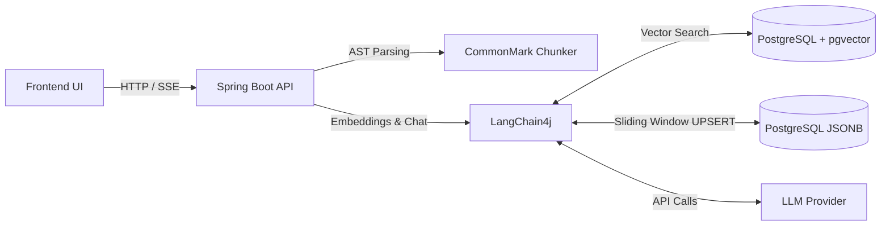

# Second Brain: RAG Knowledge Engine

A stateful Retrieval-Augmented Generation (RAG) backend engineered to transform personal Markdown notes into a fully searchable, conversational knowledge base. 

Built with Java and Spring Boot, this API orchestrates semantic search, vector embeddings, and LLM context management, acting as the intelligent backend for a personal "Second Brain" note-taking application.

## 🏗️ System Architecture

💻 Tech Stack
Core: Java 21, Spring Boot 3
AI / RAG Orchestration: LangChain4j
Database & Vector Store: PostgreSQL, pgvector, HNSW Indexing
Infrastructure: Docker (via OrbStack)
Parsing: CommonMark (AST)

🚀 Getting Started
Prerequisites
Java 21+
Maven
Docker (OrbStack recommended for macOS)
OpenAI API Key (or equivalent local LLM provider like Ollama)

Setup
Spin up the database
Run the pgvector container: docker run -d --name pgvector-db -e POSTGRES_USER=postgres -e POSTGRES_PASSWORD=password -e POSTGRES_DB=secondbrain -p 5432:5432 pgvector/pgvector:pg16

Configure environment variables
Add your API keys to src/main/resources/application.properties:
langchain4j.open-ai.chat-model.api-key=${OPENAI_API_KEY}

Run the application
mvn spring-boot:run
